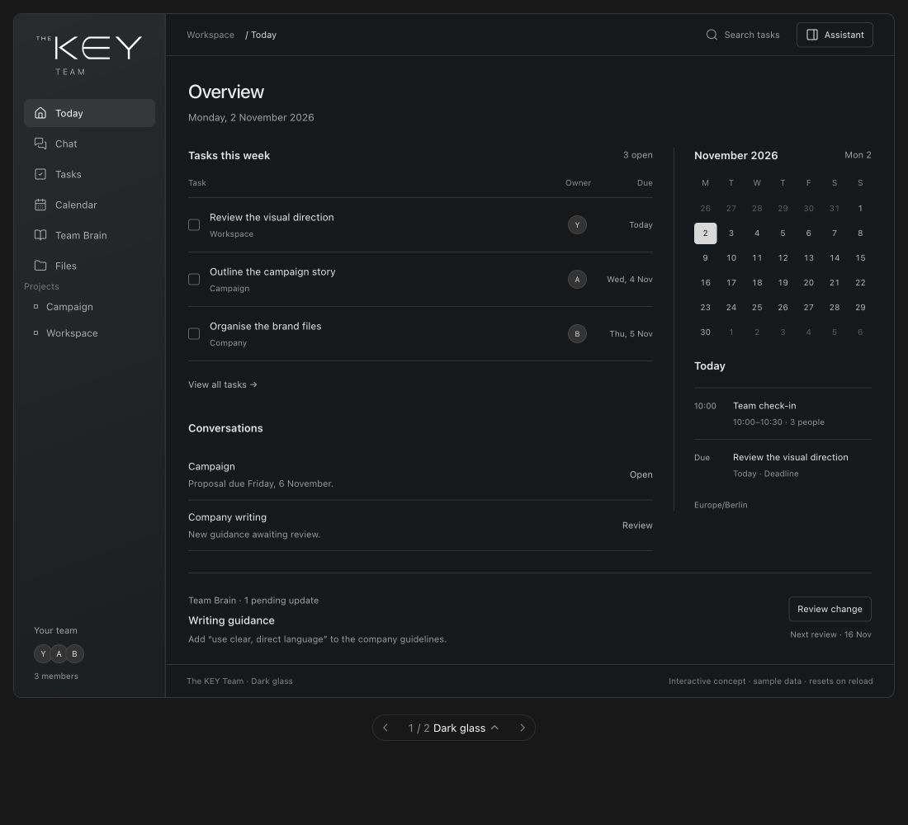
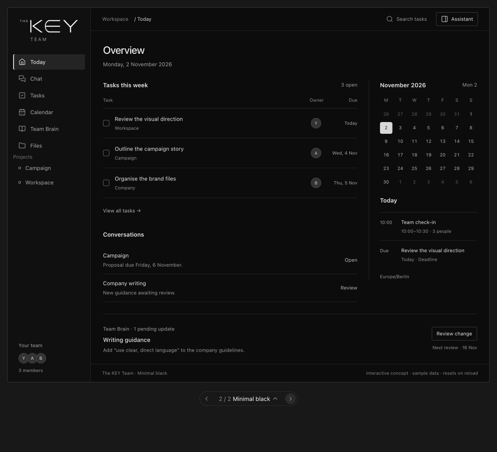

# The KEY Team — visual comparison

2026-11-02 · Interactive concepts with synthetic data. No application changes.

The product name and supplied company logo are confirmed. The visual direction is still open. Both concepts
show the same tasks, dates, navigation and knowledge proposal, so the comparison
is about presentation. The refined Dark glass uses subtle translucent navigation
and unframed content. Minimal black uses flat monochrome surfaces. Both now use
compact task rows, a month grid/agenda and the exact supplied logo displayed white.
See [component references and logo handling](component-references.md) for the
21st.dev review and implementation boundaries. The original concepts are preserved
in Git history at `b0b3ebd19c`.

| Dark glass | Minimal black |
| --- | --- |
|  |  |

## Open the interactive comparison

Download/open [index.html](index.html) in a browser, or from the repository root:

```sh
python3 -m http.server 31120 --bind 127.0.0.1 --directory project-assessment/design
```

Open `http://127.0.0.1:31120/`. GitHub's file viewer displays source; it does not
run the interaction. This preview server serves static concepts only and does not
start Macro, databases or any AI service. Stop it with Ctrl-C.

The standalone wrapper loads pinned Lucide and Floating UI assets from unpkg;
it is not a fully offline bundle. The mockup itself makes no API/model requests. Screenshots remain available
without the interactive runtime. Do not enter real company data into a concept.

`comparison.fragment.html` is the editable source; `index.html` is its rendered
standalone export. Regenerate the latter after editing the former using the
visualize skill's `scripts/render.py` exporter. The source also renders inline in
the design conversation. Keep the exported file and screenshots aligned.

Regeneration requires Python 3 and the optional **OpenAI bundled visualize skill
version 1.0.66**, which provides `scripts/render.py`. Viewing the committed export
requires neither Python nor the skill. If the skill is installed, set its directory
and run from the repository root (replace the placeholder path):

```sh
VISUALIZE_SKILL_DIR=/path/to/visualize/1.0.66/skills/visualize
python3 "$VISUALIZE_SKILL_DIR/scripts/render.py" \
  project-assessment/design/comparison.fragment.html \
  project-assessment/design/index.html \
  --title 'The KEY Team — visual comparison' --force
```

Mobile layout evidence is split into [top](mobile-top.jpg) and
[bottom](mobile-bottom.jpg) viewport captures at 320px; together they show the
navigation, tasks, calendar, review action and footer without relying on an iframe
full-page capture.

## Review interactions

1. Use the bottom carousel to switch Dark glass / Minimal black.
2. Mark a task complete. Its status is reflected in the calendar and task views.
3. In Chat, confirm the campaign-proposal task. Tasks and Calendar should show one
   new record, even if the same suggestion is revisited.
4. In Tasks, compare List and Board and search a task title.
5. In Team Brain, inspect the original source, then approve or dismiss the writing
   proposal. Today should reflect the resulting review status.
6. Open Assistant to inspect the proposed model/context surface. Its response is
   illustrative; selecting a model does not contact a provider.
7. Reload to reset sample data and compare the starting states again.

Preview controls work in memory. Calendar editing, global search, authentication,
real model/tool requests, storage and scheduled reviews are not implemented here.
For the proposed actual behavior and architecture, read [the blueprint](../product-blueprint.md).

## Verification

Browser verification and its exact coverage are recorded in [design checks](verification.md).
Application runtime evidence remains in [test results](../test-results.md).
