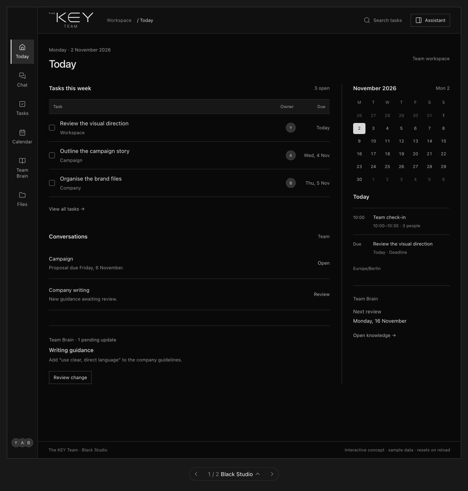
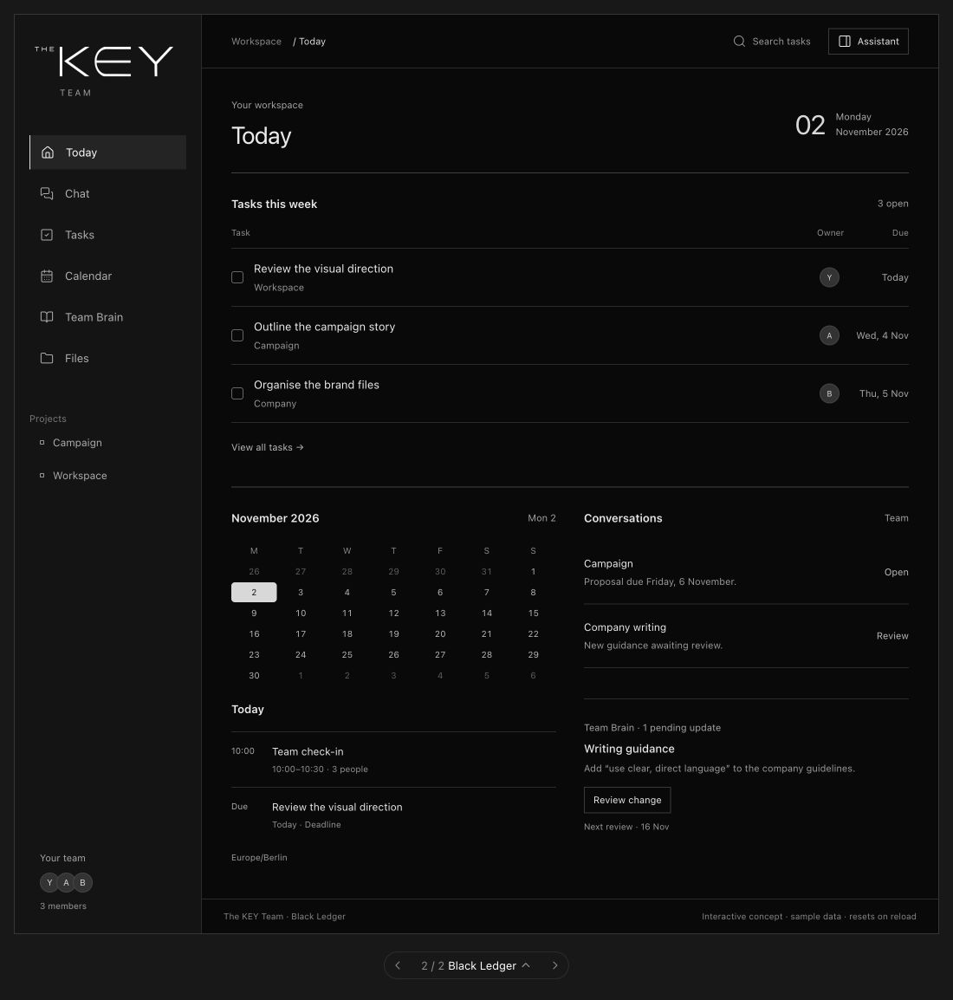

# Two additional black directions

2026-11-02. **Black Studio is selected as the design direction.** Black Ledger is
retained as an alternative reference. Application implementation is pending.
These are two additional concepts; the existing Minimal black comparison is
preserved unchanged in [index.html](index.html).

| Black Studio | Black Ledger |
| --- | --- |
|  |  |
| Narrow icon-and-label rail; logo in the top bar; compact task rows and a persistent desktop agenda column | Wider sidebar with a larger logo; full-width task list; calendar and conversations below the tasks |

Both retain flat black surfaces, square controls, the exact supplied logo displayed
white, the same sample records and the existing six navigation destinations. They
avoid decorative gradients, promotional copy and ornamental cards. This comparison
changes composition and spacing rather than just recolouring the same screen.

## Open and reproduce

Open [black-variants.html](black-variants.html) locally, or use the static server
command in [the design README](README.md), then visit
`http://127.0.0.1:31120/black-variants.html`. GitHub shows HTML source rather than
running the mockup. The bottom carousel switches between the two directions.

The editable source is [black-variants.fragment.html](black-variants.fragment.html).
The same optional visualize 1.0.66 exporter described in the design README can
regenerate the standalone file:

```sh
VISUALIZE_SKILL_DIR=/path/to/visualize/1.0.66/skills/visualize
python3 "$VISUALIZE_SKILL_DIR/scripts/render.py" \
  project-assessment/design/black-variants.fragment.html \
  project-assessment/design/black-variants.html \
  --title 'The KEY Team — two black directions' --force
```

Use the same review interactions as the earlier comparison: complete a task, switch
layout, confirm a task in Chat, inspect its calendar deadline, and review a proposed
knowledge update. State is shared across the two variants so a style switch does
not change the underlying scenario. Reload resets all sample changes.

Desktop keeps left navigation in both designs. At narrow widths the navigation
reflows into labeled rows and supporting content stacks. The logo's image bytes
and display filter are unchanged from the reviewed baseline.

## Scope

This is visual exploration only. No theme has been applied to Macro, no new model
or connector has been installed, and no real task/calendar/knowledge write occurs.
The Macro stack was stopped during design selection; it later resumed for the
separate storage repair. Black Studio establishes the visual direction and has
not yet been applied to the application.

## Verification

Browser review on 2026-11-02 covered both desktop layouts at 1100 px, tablet
layout at 736 px and narrow mobile layout at 320 px. Neither design overflowed
horizontally at the inspected widths. The desktop application frames have the
same 1060 px height for comparison. Mobile evidence:

- Black Studio: [top](black-studio-mobile-top.jpg), [bottom](black-studio-mobile-bottom.jpg).
- Black Ledger: [top](black-ledger-mobile-top.jpg), [bottom](black-ledger-mobile-bottom.jpg).

Keyboard task completion retained focus; switching variants preserved completion
and updated the calendar deadline. Reviewing and approving the sample knowledge
proposal updated both layouts. Tasks navigation and reload-to-reset were also
exercised. These checks validate the mockup, not Macro integration or persistence.
