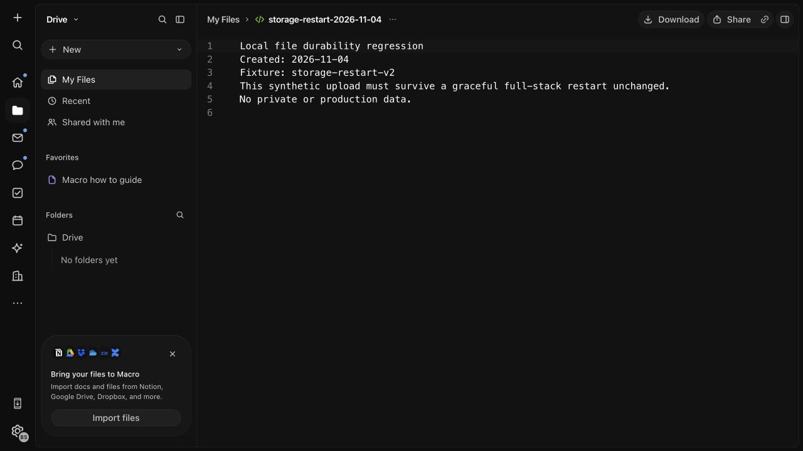

# Local file persistence repair

Verified: 2026-11-04. Branch: `assessment/local-storage-persistence`.
Parent: `80bf39391071406f9467b49e6675c50f799e6736`.

## Problem and change

The original LocalStack Community 4.14.0 container lost its S3 buckets and objects
after an ordinary stop/start. Its anonymous `/var/lib/localstack` volume did not
persist the running emulator's object and resource state. The original failed
fixture remains lost; it was not reuploaded and counted as a recovery.

The generated local service and legacy `start_localstack` recipe now use
`gresau/localstack-persist:4.14.0`, pinned to multi-platform manifest digest
`sha256:02045e045f1f3868c3cadef78de2a7c048840f48ffd506babf4a36f42a4845ba`.
The wrapper retains the same LocalStack version and adds persistence. No
application storage API, credentials or endpoint changed.

Compose mounts its instance-scoped `localstack_data` volume at `/persisted-data`.
The legacy recipe uses `macro_localstack_data` at the same destination. Metadata
saves every second; shutdown allows 60 seconds for a final flush. Ordinary
stop/start and container replacement preserve the volume. Explicit clean
initialization and volume deletion still destroy its contents.

## Dependency review and limits

The [wrapper source](https://github.com/GREsau/localstack-persist/tree/v4.14.0)
was inspected at tag `v4.14.0`, commit
`2c15f6fa2e66f228f27212b46f913208d1201523`: Dockerfile, configuration, persistence
hooks, state handling, S3 storage and serialization. It is Apache-2.0 licensed.
The upstream README describes limited maintenance after LocalStack's transition
away from open-source releases. The image pin prevents silent tag changes; it
does not establish production suitability or a full security audit.

This is a development dependency for synthetic trial data. S3 bytes are written
to disk, but metadata is saved periodically with non-atomic writes. An abrupt
kill, power loss, corrupted snapshot or disk failure was not tested. The wrapper
can log a restore error while the emulator remains healthy, so a health check
alone is insufficient. Its deserializer restores Python objects; use only
trusted locally generated snapshots and do not import untrusted persistence
directories. Keep real team data off this setup until production storage and
complete backup restoration have been assessed.

The upstream initialization snapshot excludes LocalStack. A full application
backup must additionally include this entire volume, databases, auth and sync
state, plus required configuration. The volume contains encryption keys as well
as objects. Do not commit it or publish it as a test artifact. See
[backup scope](remote-setup.md#private-networking-and-storage).

## Existing-instance migration used here

1. Stopped the previously failing agent harness loop; retained all databases,
   containers, generated environment and certificates.
2. Started the old emulator and confirmed its bucket list was empty. Copied its
   old volume contents and temporary S3 directory to an ignored local backup.
   The original anonymous volume was retained.
3. Generated an override for a separate unused configuration-check instance,
   then copied only its LocalStack service block into the existing override,
   retaining the original port. Backed up the existing override first. This
   avoided replacing the headless frontend configuration or certificates.
4. Used the existing project, base Compose file, override and environment file
   to recreate only `localstack` with `up -d --no-deps --no-build --wait`.
   Verified the pinned image, healthy state and named persistence mount.
5. Ran `localstack-provision` once to recreate the already-missing resource
   definitions. Existing application and authentication databases were not reset.
6. Started existing infrastructure before dependent services. On this initial
   recovery, the static file CDN was started again after its upstream became
   ready. The subsequent restart used dependency ordering from the outset.

This was an **empty-store migration**, not a general import of populated
Community LocalStack state. For a populated old instance, export and validate
all live objects, resource metadata, queues and keys before replacement. Do not
infer that copying `/var/lib/localstack` alone is a usable backup.

Do not run `stack up`, `run_local`, `reset_local`, a seed reapplication or
`down -v` on the preserved instance. See [local setup](local-setup.md) and the
[development guide](../docs/development/running-locally.md) for safe recovery.

## Verification

| Result | Check | Evidence |
| --- | --- | --- |
| Expected failure | Regression against original image | First stop/start failed with `NoSuchBucket` |
| PASS | Isolated regression against pinned replacement | Object bytes, content type, hash metadata, presigned GET, DynamoDB record, retained SQS message, S3 notification configuration and KMS ciphertext decryption survived stop/start and forced replacement with fresh anonymous volumes |
| PASS | Tooling suite | `cargo test -p xtask_local -- --include-ignored`: 129 passed, 0 failed, including the Docker regression |
| PASS | Browser upload before restart | New 188-byte text fixture opened and downloaded; exact byte comparison passed |
| PASS | Full local application stop/start | All 29 working containers stopped; same containers resumed with infrastructure readiness gates; no resource provisioning, seed or reupload between checks |
| PASS | Browser read/download after restart | Same file opened in a fresh tab; downloaded bytes matched the original and pre-restart copy |
| PASS | New upload after restart | A second 101-byte file appeared, opened and downloaded byte-for-byte; upload-finalizer logs confirmed its S3 object-created event was processed |
| PASS | Existing chat and document content | The prior trial's chat message and collaborative document edit markers remained visible after migration and restart; no reseed |

The retained fixture's SHA-256 is
`b92f8f66db1ec41f5e6a33e40121c0925b638d2c2421ce978886e405bd71507c`.
The post-restart new upload's SHA-256 is
`33c08abf42fa0f1d59af6d7601cf0f89c24a9b71ae14aa5b74ce3e321114c036`.
Fixtures and downloaded copies remain outside tracked application source.



## Reproduce

From the pinned Nix shell, with Docker running and `SQLX_OFFLINE` unset:

```bash
cargo test -p xtask_local local_aws_data_survives_restart_and_container_replacement -- --ignored --nocapture
cargo test -p xtask_local -- --include-ignored
```

Choose either the focused command or the full crate suite. The Docker test
generates the real LocalStack service into its own unique Compose project,
publishes no ports, and removes only that project's test containers and volumes.
It does not access the preserved application instance. The automated probe
checks notification configuration, not event delivery; the subsequent browser
upload and finalizer observation supplied that delivery evidence separately.

For a browser repeat: upload a uniquely named synthetic file, download and hash
it, stop the exact instance containers gracefully, start infrastructure and wait
for readiness before dependents, then open the file in a fresh tab and compare a
new download. Do not run provisioning or reupload between the two checks.

## Remaining work and runtime state

The 29 core containers are running after verification. Agent harness and AI
editing worker remain stopped because of the previously documented startup
failures. A later [recovery pass](backup-and-recovery.md) added ordered stop/resume
and verified complete cold restoration into separate volumes. Logout configuration,
AI startup and production storage remain open. This repair does not certify
the entire application or change the selected visual design.
