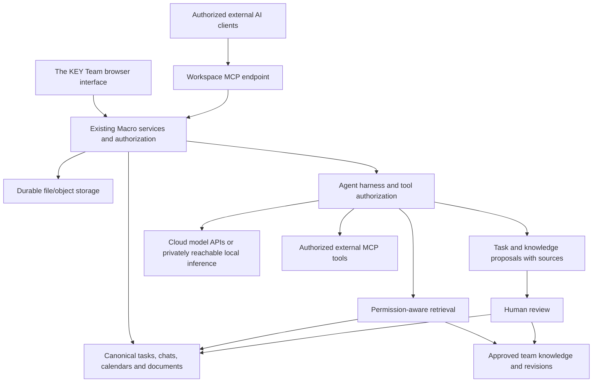

# The KEY Team — product blueprint

Date: 2026-11-02. Scope: a private workspace for one team of 2–3 people.
Status: planning and interactive concepts, not implemented application changes.
The local Macro stack remains stopped. This document separates accepted decisions
from the proposed design and from behavior verified in the local trial.

## Accepted decisions

- Product name: **The KEY Team**. Use the supplied **THE KEY** company logo with
  a separate **TEAM** descriptor. Retain upstream license and copyright notices.
- Reuse most of Macro. Keep left-side navigation and give the workspace its own
  identity. Compare **Dark glass** and **Minimal black** before selecting a theme.
- Tasks live inside this application, with lists/boards, owners, status and
  deadlines. An external Notion workspace is not the task source of truth.
- The team brain is separate from the owner's personal Obsidian project tracker.
  Keep worthwhile shared context; the owner approves durable knowledge updates.
- Detect possible tasks and useful knowledge in authorized conversations. Provide
  source references and distinguish suggestions from accepted records.
- AI should understand authorized chats, calendars and current work, and support
  permitted calendar/task actions. Shared company identity and writing guidance
  should be usable across Claude, GPT and a potential local model.
- Review the team brain every 14 days. Update task completion when it happens;
  review stale context and archive proposals during the periodic review.
- MCP interoperability is required, including assessment of Higgsfield and
  Lovable workflows. Their exact tools, access and connection direction need proof.
- GitHub holds code, detailed decisions, architecture and reproducible checks.
  The personal vault holds only important milestones and links.
- Future development is accessible from Mac and Windows through GitHub/cloud
  sessions. Dedicated hosting follows resource assessment and integration proof.

## Proposed interface

| Navigation | Responsibility |
| --- | --- |
| Today | Priorities, upcoming meetings, overdue work and knowledge approvals |
| Chat | Channels and direct conversations, with source-linked suggestions |
| Tasks | Projects, list/board views, ownership, deadlines and completion |
| Calendar | Meetings, deadlines and explicit scheduled work blocks |
| Team Brain | Approved company context, decisions, procedures and review queue |
| Files | Documents, uploads and generated assets associated with projects |

Search is global in the intended product. The mockup demonstrates task search only.
AI is available alongside the current work; the concept opens a contextual panel.
Preserve Macro's sidebar/content split, compact controls, system typography and
familiar conversation structure. The Today overview and curated Team Brain are
proposals, not claims about the current app.

Desktop is the initial review target. On small screens the concept reflows its
navigation and stacks content; a production mobile menu and native app scope need
their own implementation review. Keep all essential actions keyboard/touch usable.

### Visual comparison

- **Dark glass:** charcoal content, a softly translucent neutral sidebar and
  compact unframed work areas. Text surfaces remain readable; glass has an opaque
  fallback and respects reduced-transparency preferences. The refinement removes
  coloured glow, large cards and promotional copy following design feedback.
- **Minimal black:** flat near-black surfaces, monochrome controls, sharper corners,
  separators and fewer framed panels. The same content and information hierarchy
  make the stylistic tradeoff directly comparable.

Both use synthetic tasks and conversations. Try navigation, list/board layout,
task completion, a chat-to-task confirmation, knowledge approval/dismissal, source
inspection and the illustrative AI panel. Changes exist only in browser memory
and reset on reload. The model selector does not connect to a provider.

See [the comparison and screenshots](design/README.md). A visual direction has
not yet been selected. The supplied company logo replaces the provisional wordmark.
The [component study](design/component-references.md) records 21st.dev references
and the boundary between visual inspiration and installing third-party code.

The black appearance is now preferred. Two additional layout studies,
[Black Studio and Black Ledger](design/black-variants.md), are available alongside
the retained Minimal black concept. The final layout decision remains open.

## Workflows and records

### Conversation → task → calendar

1. The AI examines content the current user is allowed to access. A direct
   commitment may produce a suggestion containing its source, proposed owner and
   date. Missing/ambiguous dates or owners remain unset until clarified.
2. A teammate confirms or edits the suggestion before creation. Repeated
   extraction of the same commitment must not create duplicate tasks.
3. Store one canonical task in the existing task system. The calendar reads its
   deadline; a deadline does not automatically reserve time or invite anyone.
4. Scheduling a work block or meeting is a separate action with a start, end,
   timezone and participants. Resolve relative dates using the source timestamp
   and workspace/user timezone, then display the exact date for confirmation.
5. Completion updates the task and its calendar presentation immediately. A
   correction can reopen it. Periodic brain review must not control task status.

Proposed task fields: existing task identifier, project, title, status, assignee,
due date/date-time, source references and revision metadata. Reuse existing fields
and APIs after tracing them; this is not a new database schema proposal.

### Conversation → approved shared knowledge

Sources, operational tasks and durable knowledge have different responsibilities:

| Record | Authority | Lifecycle |
| --- | --- | --- |
| Original source | Existing chat/document/calendar record | Retained under its access and deletion rules |
| Task suggestion | Proposed interpretation, not a commitment | Confirm/edit/dismiss; keep source linkage |
| Task | Existing canonical task record | Open/in progress/completed/reopened |
| Knowledge proposal | Suggested addition/correction/archive | Show current text, proposed change, source and scope |
| Approved knowledge | Owner-approved shared record | Versioned, editable, citable, exportable and restorable |

Company profile, writing guidance, active decisions and procedures belong in shared
approved context. Provider prompts describe model behavior; they must not become
inconsistent copies of company knowledge. Permission-aware retrieval supplies the
same current authorized records to every model.

Owner approval applies to durable knowledge changes. This does not require the
owner to approve every teammate's ordinary task edit. The first implementation
should require confirmation for AI writes; later routine automation can use
explicitly agreed rules. Invitations, destructive changes, publishing and paid
tool actions need clearly scoped authorization. Record who acted and the result.

Knowledge must retain provenance and access scope. Promoting a private source to
team knowledge is not implicit permission to expose it. Recheck access when
reading, summarizing and executing tools. Revocation/deletion must propagate to
retrieval, derived summaries and caches. Corrections supersede obsolete knowledge;
archived material remains historical, not current guidance.

### Fortnightly review

Every 14 days, prepare a concise draft of stale records, conflicting decisions,
completed work and proposed archival. The owner approves the resulting changes.
Prefer archival with history to irreversible deletion; explicit deletion still
needs a supported path. Do not promote every chat message into permanent memory.

The concept uses 2 November → 16 November 2026 as a sample cadence. No real
automation, calendar appointment or notification has been scheduled. The actual
first run, time, timezone and notification destination remain open.

## Logical architecture and ownership

This is a logical design, not a new microservice plan. Start with the existing
Macro service structure. The inspected personal memory table is not evidence of
a canonical shared brain: its records are per-user and local generation is gated.
Prefer curated collaborative documents plus a small approval/revision layer if
they satisfy the requirements. The final storage representation must follow a
focused review of existing knowledge, retrieval and permission paths. Do not add
a separate vector database or sync the personal vault into the team app by default.

| Concern | Existing location / planned boundary |
| --- | --- |
| Shell, branding and themes | `apps/web/src/components/app/`, `apps/web/src/features/theme/` |
| Existing task/calendar behavior | `docs/agent-guide/tasks.md`, `docs/agent-guide/calendar.md`; trace their callers before editing |
| Model routing | `crates/agent/src/model/router.rs`; compatible-provider registry already exists |
| Agent and MCP execution | `services/agent_harness_service/`; authentication/startup still unresolved locally |
| Current memory implementation | `crates/memory/`; per-user behavior must not be relabeled as shared memory |
| Data and search | Existing PostgreSQL, collaborative sync state, object storage and OpenSearch; see architecture findings |
| Development environment | Repository + reproducible setup; disposable compute, no sole copy of application data |
| Deployment | Dedicated persistent Linux host after assessment; backups outside the host with tested restore |

Backups must cover databases, collaborative state, uploaded objects and required
keys/configuration. Keep application content and credentials out of the public
repository. Public source does not make the running workspace publicly accessible.

## Models and MCP

Claude and GPT are initial provider targets. A local model is an optional provider
behind the same authorization and retrieval boundary. Ollama supports a subset of
the OpenAI API, and Macro's router can register compatible providers. End-to-end
support still needs model registration/configuration, streaming, tool calling,
usage/error handling and permission tests. API shape alone is not sufficient.

Assess the chosen model against actual GPU/VRAM, context size and concurrent use.
A Windows host must be powered on and privately reachable for teammates; a
dedicated inference host provides a separate availability boundary. No hardware
purchase or model download is authorized by this blueprint.

MCP has two distinct directions: the workspace calling external tools, and
authorized external clients reading or acting on workspace data. Each connector
needs explicit tools/scopes, authorization/revocation, failure handling and an
activity record. Secrets stay in ignored configuration or an approved secret store.

- Higgsfield documents an official MCP endpoint for creative operations. Verify
  authentication, tool availability, generation costs and result attachment before
  enabling writes. No connection has been installed or tested here.
- Lovable documents consuming external MCP connectors. A permitted workspace
  endpoint could expose context to it. This does not prove an inverse API that
  lets this workspace control Lovable. Define and test each direction separately.
- Tasks remain internal. A future Notion connector can be assessed separately;
  do not introduce a second task master or silent bidirectional synchronization.

Primary references, checked 2026-11-02: [Ollama compatibility](https://docs.ollama.com/api/openai-compatibility),
[Lovable connectors](https://docs.lovable.dev/integrations/chat-connectors),
[Higgsfield integrations](https://higgsfield.ai/enterprise-help-center/platform/integrations).

## Implementation sequence and evidence gates

| Stage | Deliverable | Acceptance evidence |
| --- | --- | --- |
| Product definition | This blueprint and two comparable mockups | Owner selects or refines a direction; unresolved choices stay labeled |
| Durable baseline | Fix storage persistence, readiness/startup and logout configuration | Uploaded bytes survive restart; full restore succeeds in a separate instance |
| Internal work loop | Reuse tasks/calendar; source-linked chat suggestion with confirmation | Two users create/assign/complete tasks; exact dates, no duplicates or unsolicited invitations |
| AI and tools | Fix harness/worker startup; connect approved model providers and MCP | Allowed/denied reads and writes, revocation, failed-tool behavior and source citations demonstrated |
| Shared knowledge | Review queue, canonical approved context, revision/archive/export | One user approves a decision; another retrieves it through a different model; correction/revocation works |
| Private hosting | Assessed Linux development/deployment environment and recovery procedure | Capacity preflight, reproducible build, private access, monitoring and tested backup restoration |

The implementation priority remains durability and recovery. Product design does
not require restarting the application. No application feature, provider request,
MCP connection or scheduled review is certified by a successful mockup interaction.

## Decisions still open

- Dark glass, Minimal black, or a refined combination; final accent and production logo asset format.
- Final shared-knowledge storage/editing implementation after reuse assessment.
- Calendar provider, meeting/invitation rules, first review time and notification destination.
- Exact model choices, local inference hardware and connector scopes.
- Cloud development host and dedicated deployment sizing from measurement.

For existing runtime evidence and unresolved failures, see [test results](test-results.md).
