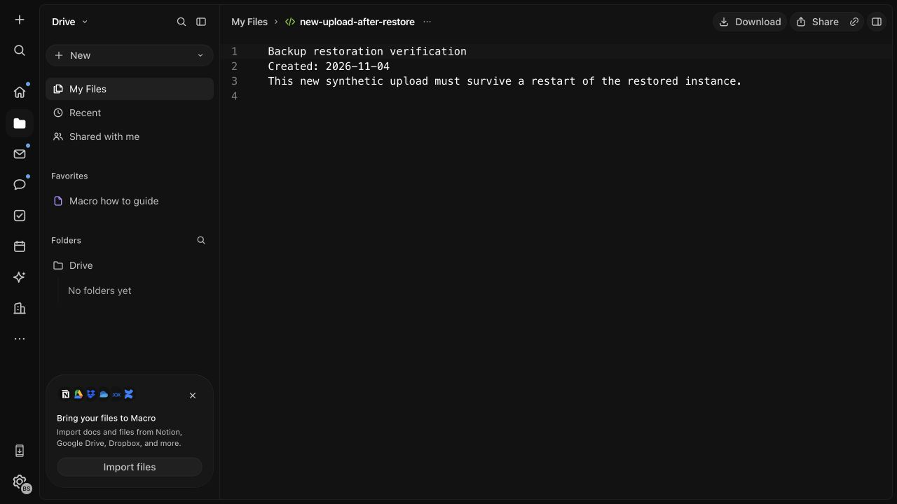
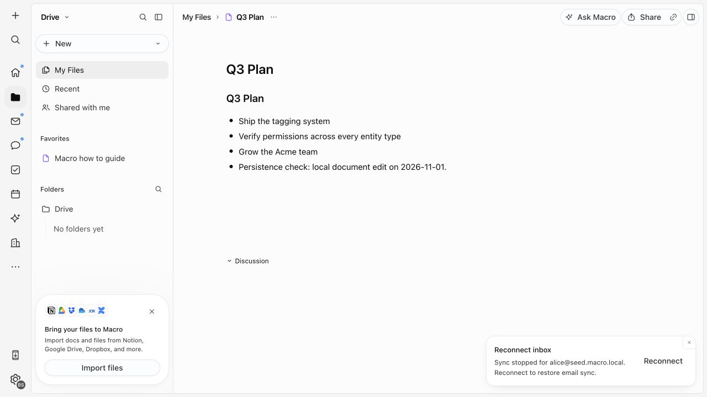
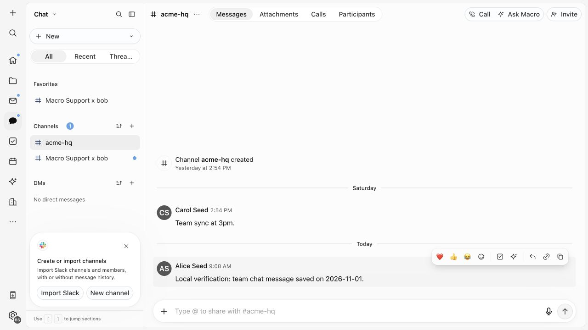

# Verification results

Initial runtime verification: 2026-11-01. Storage retest: 2026-11-04.
Initial tooling checks: 2026-10-29.
Baseline: `3953a658d877ddfcd8c4724e0b5d66f02de008f3`.
Initial branch: `assessment/local-smoke-test`.
Current branch: `assessment/backup-restore-startup`.

## Latest result: complete local backup restore and ordered startup

On 2026-11-04, a cold backup captured 11 data volumes and 23 runtime archives
(approximately 414 MiB compressed). It resumed the original 29 core containers.
The complete copy was restored into a separate instance with no shared source
mounts. Exact images were reused on the same ARM64 Docker engine; no initialization,
resource provisioning or reseed was used.

All 29 restored core services reached running state, with configured healthchecks
healthy. A fresh passwordless sign-in succeeded. The existing chat message and
collaborative document edit were visible. The original 188-byte file downloaded
with its original SHA-256. A new 127-byte upload also opened and downloaded exactly.
Synthetic S3 bytes/metadata/presigned GET, DynamoDB data, retained SQS message,
notification configuration and decryption of the original KMS ciphertext passed.

Negative checks refused the original instance name, a running source, corrupted
configuration and a backup directory inside a captured runtime bind. The startup
command rejects missing containers/state and the update command no longer falls
back to initialization. An initial backup rejection resumed the source correctly.
The initial restore caught analytics imports that depended on the host checkout;
the corrected restore links its private source to dependencies in the pinned Linux
image. Repeated restoration accepts only that expected dependency link.

The [recovery runbook](backup-and-recovery.md) documents scope, commands, shutdown
limits, private artifact handling and remaining production requirements. Logout
still redirects to the unused development origin; the browser test returned to
the verified HTTPS welcome page in a fresh tab. AI services remain excluded.
This is not a production-readiness claim or a test of abrupt disk/host failure.

The restored copy then completed an ordered stop/resume without replacing any of
its 29 containers. A fresh browser download of the new upload retained all 127
bytes and SHA-256 `5824a6ac2a2c3bf230a53d8dd47e6ef4aa3aeec7325a47548bd3406f083e75d5`.
The full local AWS probe, including original ciphertext decryption, passed again.
`cargo test -p xtask_local -- --include-ignored` passed **138 tests, zero failures**.
The existing SSH test was run while port 31023 was free. Scoped strict Clippy,
workspace formatting, `just check`, privacy and secret checks passed independent
review. Full-workspace all-feature Clippy was not run on this constrained host;
GitHub Actions remain disabled as requested. See the runbook for retained local
artifacts and the exact limits of the test.

## Earlier retest: local file persistence repaired

On 2026-11-04 the local storage service changed to a digest-pinned persistence
wrapper and an instance-scoped volume. The new Docker regression failed on the
original image with `NoSuchBucket`, then passed on the replacement. All 129
`xtask_local` tests passed, including object/resource/key retention across a
graceful restart and forced replacement with fresh anonymous volumes.

A new 188-byte file uploaded through the browser downloaded byte-for-byte before
and after stopping and starting all 29 working application containers. The
post-restart check used a fresh tab, without resource provisioning, reupload or
database initialization. A second new upload after restart also opened and
downloaded correctly; the finalizer processed its storage event. Hashes,
reproducible commands, dependency review and visual evidence are in the
[storage repair record](local-storage-persistence.md).

`just check`, `just pr-privacy`, workspace formatting and strict Clippy for
`xtask_local --all-targets` passed. Full-workspace Clippy was not run: it expands
into all-feature checks of the complete application workspace on this constrained
local host. Browser evidence was produced by the primary verifier; the independent
auditor reviewed the patch and ran the scoped checks, without operating the stack.

The 29 core containers remain running; the two failing AI services remain stopped.
No real mail, calendar, AI provider or external MCP connection was added. At this
earlier checkpoint, complete backup restore and automatic startup were still open;
the later recovery result above supersedes those gaps. Abrupt-failure recovery and
the logout destination remain unverified or unresolved. This local repair does not
establish production readiness. The original missing file was not recovered.

The sections below retain the original trial evidence, including its failures;
they are historical results, superseded only where the retest above says so.

## Initial outcome and boundary

The macOS ARM development build completed and the local browser demonstrated
login, chat, collaborative document editing and file transfer. This is useful
proof for reuse by a small team, but the full stack is not verified or ready for
real data. File durability failed, two AI services failed startup, and restart
recovery needed manual steps. Only assessment documentation changed in Git.
No production deployment, cloud machine, model request or external MCP request
was used. Synthetic test data is separate from any personal knowledge vault.

## Shutdown checkpoint

On 2026-11-02 the operator requested stopping the local preview. The 29 running
containers with Compose project label `macro-mac-smoke` were stopped. A subsequent
label-filtered Docker query returned zero running containers. Existing containers,
database volumes and generated instance configuration were retained; no reset or
fresh initialization was performed. Runtime results below describe the prior test,
not currently running services.

## Environment and builds

| Result | Check | Evidence |
| --- | --- | --- |
| PASS | Host capacity | M3 Pro, 12 CPU cores, 18 GiB RAM; approximately 242 GiB free disk before setup and 180.5 GiB at a later runtime sample |
| PASS | Docker prerequisites | Engine 28.0.4, Compose 2.34.0-desktop.1; ARM64; 12 CPUs and about 7.65 GiB container RAM; container execution, repository bind mount and loopback forwarding passed |
| PASS | Nix toolchain | Nix 2.35.4; pinned shell supplies Cargo 1.94.0, Bun 1.3.13 and Just 1.57.0 |
| PASS | `just doctor-local --instance mac-smoke --port-base 31000` | All prerequisite checks, including 33 free host ports |
| PASS | Linux ARM binaries | All 15 unified binaries plus separate search worker built with two jobs and debug symbols disabled |
| PASS | Frontend | Frozen Bun install, all eight WebAssembly components and static frontend bundle completed |
| PASS | Supporting images | Runtime, agent sandbox, OpenSearch with analysis-icu, sync, lexical, websocket, analytics, AI editing and SDK relay images built |
| PARTIAL | Initial stack startup | Command exited 0 and backend readiness passed; 29 of 31 containers running, agent harness restarting and AI editing worker exited |
| SAMPLE | Runtime resources | About 4.8 GiB summed container memory and 202% aggregate Docker CPU during troubleshooting; not a stable idle or peak measurement |

The sandbox image was about 15.1 GB; runtime image about 331 MB. The outer checkout
and Nix inputs are pinned, but the sandbox Dockerfile clones a moving upstream
default branch and some container tags are mutable. This is not a fully pinned
image build. No load test or remote sizing minimum was established.

## Browser and data checks

| Result | Check | Observed evidence |
| --- | --- | --- |
| PASS | Email login | Two seeded accounts reached the authenticated application through the HTTPS proxy |
| PASS | Team chat write/read | First account sent a timestamped test message; it appeared in the team channel |
| PASS | Document edit | Seeded planning document loaded; a timestamped persistence marker was appended |
| PASS | File upload/read/download before restart | A 115-byte synthetic text file rendered and downloaded; bytes matched the original exactly |
| PASS | Chat persistence | Fresh browser navigation after stop/start displayed the saved message |
| PASS | Collaborative document persistence | Fresh navigation after stop/start displayed the appended marker |
| FAIL | Uploaded file persistence | After stop/start the viewer returned HTTP 403; LocalStack had lost resources and the test object was absent after resource reprovisioning |
| PASS, limited | Seed permission matrix | All 18 entities matched expected permissions across six personas; this is a database-backed matrix, not full HTTP authorization coverage |
| FAIL | Headless logout destination | Logout sent the browser to an unused `http://localhost:3000/`; opening the verified HTTPS welcome page in a fresh tab allowed login again |
| PASS after recovery | Cross-user read | Second account read the saved channel message and document marker; the document rendered read-only as expected |
| NOT RUN | Tasks, search, three simultaneous users, permission denial through HTTP | Additional application integration checks required |

The fixture SHA-256 was
`5805c7a32dabe630350d9933163993900b41eac556b64b657246171d7227075b`.
The original fixture and its downloaded copy remain outside application storage.
It was not reuploaded to disguise the failed durability test.

The seeded scenario is `seed/scenarios/team-perms.json`; it intentionally has
more personas than the eventual two-to-three-person team. Do not apply it again
to this instance: reapplication recreates its marked rows and can erase edits.

## Restart and recovery evidence

Only this instance's existing running containers were stopped. No volumes,
database schema or generated state were deleted, and neither `stack up` nor
snapshot restoration was used for the restart test. Compose rejected `start
--wait`; retrying plain `start` succeeded. Three services exited because
LocalStack/OpenSearch were not yet ready; starting those same containers after
dependency readiness recovered them.

LocalStack then reported missing queues and file storage failed. The documented
`localstack-provision` command completed without resetting databases or volumes.
It restored resource definitions but not uploaded objects. Chat and collaborative
document markers remained visible. Later browser/API calls intermittently timed
out despite healthy backend container status. Stopping the repeatedly failing
agent harness and restarting only the proxy restored an HTTP 200 frontend probe;
the second account then read both persisted markers. The exact timeout cause was
not established. The harness remains stopped to avoid its crash loop. Final status
showed 29 of 31 containers running; both AI services were stopped/exited. These observations do not establish reliable unattended restart.

## AI and remaining integration gaps

| Result | Area | Blocker or missing evidence |
| --- | --- | --- |
| FAIL | Agent harness startup | Public MCP composition could not find a Google Gmail identity provider in FusionAuth; no real provider credentials configured |
| FAIL | AI editing worker startup | Linux container found host macOS `workerd` through the repository bind mount; isolate Linux dependencies |
| NOT RUN | AI providers and external MCP | Working harness, approved credentials and actual requests required |
| NOT RUN | Shared team knowledge | Inspected memory path is per-user; local automatic generation is skipped; a canonical shared knowledge store is not demonstrated |
| NOT RUN | Backup restore | Must include relational databases, auth state, collaborative sync state, file objects and required encryption keys; restore into a separate instance |
| NOT RUN | Remote environment | No remote host selected; repeat resource, Docker and network preflight before a cloud build |

## Lightweight regression tests

These ran with Python 3.13.0 and Node.js 22.23.1 outside Nix on 2026-10-29.
They cover selected tooling, not application integration.

| Result | Command | Coverage |
| --- | --- | --- |
| PASS: 2 tests | `python3 -m unittest discover -s tooling/scripts -p test_consolidate_agent_config.py -v` | Agent config preservation and missing signer handling; mocked uploads |
| PASS: 3 tests | `node --test apps/web/scripts/write-bundle-manifest.test.mjs` | Bundle compatibility and invalid version rejection |
| PASS: 12 tests | `python3 -m unittest discover -s tooling/pii -p test_scan.py -v` | Privacy scanner and Git error handling |

Total: 17 passed, 0 failed. They were not rerun for documentation-only updates.

## Documentation checks

The independent documentation audit ran `just check`, `just pr-privacy` and
baseline diff whitespace checks successfully. It verified the permission matrix,
restart command behavior and source support for the documented limitations. Its
backup-scope link finding was corrected by adding the missing scope to the remote
runbook. Browser observations were recorded by the primary verifier; the auditor
did not independently repeat application tests or change the running stack.

No application source was changed, so package unit suites and full-workspace
lint/type-check runs are outside this documentation change. The pre-commit hook
checks staged lines for privacy and secrets before the final documentation commit.

## Visual evidence

Synthetic data only. Both views were captured while signed in as the second
seeded account, after restart and proxy recovery. The document view contains the
first account's saved edit marker and renders read-only; the channel view contains
that account's saved message.

